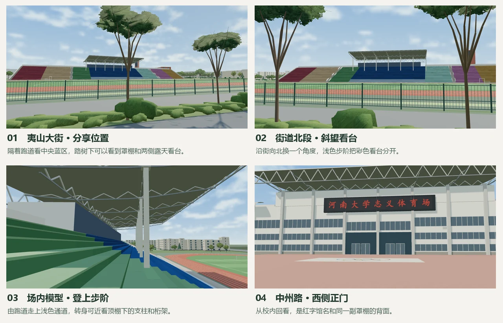
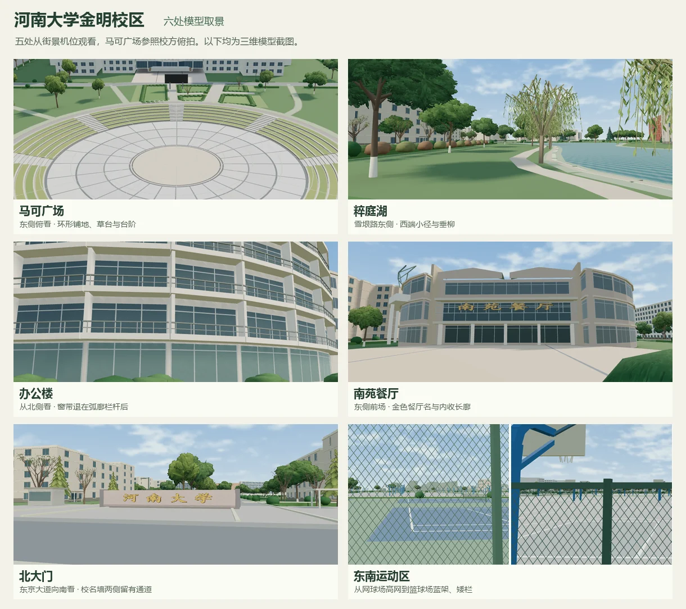
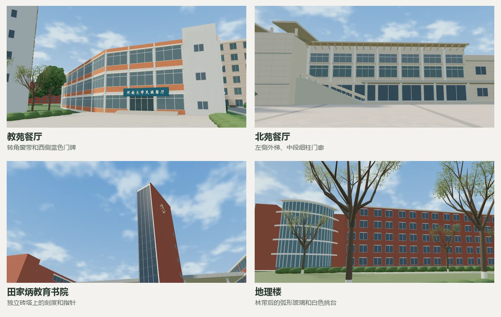
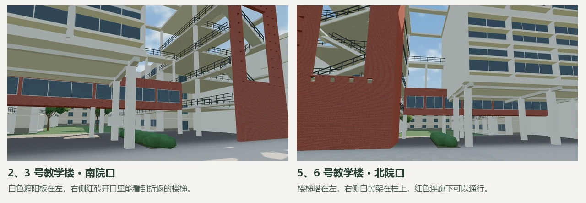

# 校园精细化模型

在原有校园数据上，根据公开街景和校方照片重建主要外立面、入口与步行空间。普通体量沿用原始轮廓和估高；有街景依据的局部（例如锥顶、架空层和图书馆后门）在显示模型中单独处理。原始数据未改动，尺寸不代表实测竣工信息。

## 运行

在此目录打开终端，执行：

```powershell
node server.mjs
```

浏览器打开 <http://127.0.0.1:4173>。模型和本地依赖可以离线加载；卫星影像、校方照片和来源链接需要联网。请通过本地 HTTP 服务打开，浏览器直接双击 HTML 可能会拦截模块和 JSON 加载。

## 查看细节

- 在左侧可按分类（重点 / 全部 / 教学 / 宿舍 / 生活 / 室外）浏览或搜索全校 58 栋命名楼宇与道路，也可在三维画面中直接点击任意建筑查看并高亮轮廓。
- 按住鼠标左键旋转，右键平移，滚轮缩放；工具栏支持回到全景、切换清晨 / 正午 / 黄昏 / 夜景时段光照与湖面微风水波，以及一键复制当前任意视角分享链接。
- 点击“地面漫游”，拖动视野，用 WASD / 方向键移动（按住 Shift 加速，Q/E 转向，支持贴墙滑行），也可点按或长按屏幕前进/后退按钮；左下角小地图实时显示位置、朝向并支持点击快速跳转。
- 在地点详情卡片点击“步行导航”，基于校园路网自动规划 A* 步行路线并在三维场景、小地图与卫星底图中高亮显示，支持“从起点漫游”。
- 点击地图右侧的相机，可按区域筛选 54 个取景视角，对照 49 个不同的百度全景和两处校方照片来源。选“上一站 / 下一站”可沿夷山大街从两个角度望向志义体育场，再到跑道边和西侧正门；也可从 2、3 号教学楼的院口走到 5、6 号楼一侧。
- [俯看马可广场](https://gavin0915023-dev.github.io/henu-jinming-map/?view=marco-bowl)会打开可旋转的三维俯视图；选“从这里漫游”从东侧台阶下到中央。地面实拍可从[西侧步道](https://gavin0915023-dev.github.io/henu-jinming-map/?view=marco-approach)对照。
- 在图书馆前可看两侧内收的玻璃幕墙、雨棚和上方的金色馆名，并与“实景参考”里的校方照片对照。明德广场中轴按原始道路数据作为步行铺地，不设机动车中心线。
- 搜“粹庭湖”到经济学院北侧看柳岸；搜“九章路石桥”到教学区看石栏。两者位于不同水面，旧石桥分享链接继续有效。也可单独打开[三种常用校园树形对照](https://gavin0915023-dev.github.io/henu-jinming-map/verification/tree-study.html)。岸柳另建；树形和种植位置不是逐株测绘。
- 不支持 WebGL 2 的设备使用画布兼容渲染，保留广场高差、主要窗墙、栏杆与球场设施，远处的细格栅和光照更简化。

## 文件

- `model.js`：原场景整合、种植位置、光照与阴影。
- `tree-model.js`：三类树形的分枝、树冠与本地生成的叶簇纹理，同形树共用几何。
- `daylight.js` / `ground-surfaces.js`：生成日光天空、墙脚和树下的柔影，以及近景地面纹理。玻璃和水面的反光来自同一片静态天空，并非实时反射周围楼宇。
- `building-detail.js`：窗框、玻璃、窗台、层间带、女儿墙、屋顶与入口构件。
- `landscape-detail.js`：运动场、道路设施、桥栏、湖岸与水面。
- `avenue.js` / `field-ground.js` / `west-gate.js`：伯襄路的路面和种植、学院门前铺地、湖边灌木、湖桥与西大门校名墙。
- `field-views.js`：实景取景点、步行相机和各自的外部图片来源。
- `wenfu.js`：报告厅的可通行门洞、临街玻璃分组和文甫路建筑轮廓；几何体也供步行碰撞和兼容渲染使用。
- `facade.js` / `software.js`：配套的图书馆西立面与兼容渲染器。
- `physics.js`：物理楼 C 座窗墙、门厅、三层连接楼和锥形报告厅，含环廊、外梯和院内台阶。
- `central-axis.js` / `east-campus.js`：图书馆后门、公共教学楼两面、东门与体育场入口。`survey-mesh.js` 将同一组表面供三维和兼容渲染器使用。
- `stadium-bowl.js`：志义体育场西看台的阶梯、步行高度、中央罩棚和夷山大街一侧的围栏。`running-tracks.js` 从原始地图识别跑道内外沿，电脑和手机使用相同的边界。
- `teaching-courts.js`：综合教学楼两处东院口的架空白翼、楼梯、红色连廊和对应的可步行空间，以及 2、3、5、6 号教学楼面向院内的走廊。
- `faculty-sites.js`：药学院南面、土建学院双翼圆廊、曾宪梓楼、学十七公寓与医院西入口的立面、通路和院前种植。
- `college-courts.js`：教苑餐厅、北苑餐厅、田家炳教育书院和地理楼。每处有独立的窗墙和体量设计；两家餐厅不共用一套立面，书院的通路和顶板开口在几何中实际留空。
- `campus-commons.js`：马可广场的下沉地面与可行走台阶、北大门、粹庭湖岸和东南球场。球场设施的朝向、不同高度的围网和入口按对应街景绘制。
- `round-buildings.js`：办公楼两面的窗廊、南门雨棚，南苑餐厅内收的东面门廊和南边带钢架的白檐。
- `routing.js` / `minimap.js`：校园路网 A* 步行寻路与漫游模式 2D 雷达小地图（支持点击跳转与路线绘制）。
- `assets/`：原始校园 JSON、Three.js、OrbitControls 与按需加载的 Leaflet 依赖。
- `index.html` / `viewer.css` / `main.js`：完整的本地查看界面。

若将改动接入原页面，请将上述场景模块与 `model.js` 放在同一目录，并保留 `assets/OrbitControls.js` 和 `three` 的 import map。

## 实拍参考细化



志义体育场可以从四个位置看：[夷山大街北段](https://gavin0915023-dev.github.io/henu-jinming-map/?view=stadium-field-north) → [分享街景的原方向](https://gavin0915023-dev.github.io/henu-jinming-map/?view=stadium-field) → [跑道边近看](https://gavin0915023-dev.github.io/henu-jinming-map/?view=stadium-track) → [西侧正门](https://gavin0915023-dev.github.io/henu-jinming-map/?view=stadium-west)。从跑道边一直向前，可以沿浅色通道登上看台。

依据 [2022 年 6 月的百度街景（朝向 292.75°）](https://map.baidu.com/#panoid=09027700122206231415580505A&panotype=street&heading=292.75&pitch=5.3)和[北侧斜看](https://map.baidu.com/#panoid=09027700122206231415533445A&panotype=street&heading=258.5&pitch=4)，中央深蓝看台上有悬挑罩棚，浅色细柱落在看台中段；两端彩色分区露天，浅色边墙随轮廓降到跑道。西侧正门另按 2014 年校内街景核对。场内近景为模型相机；排数、阶高和顶棚出挑距离按照片估计。远照不能分辨单个座椅，模型只刻画可辨认的台阶和分色。



| 本次增加或校正的位置 | 实拍如何用于建模 |
| --- | --- |
| [马可广场 · 东侧俯看](https://gavin0915023-dev.github.io/henu-jinming-map/?view=marco-bowl) | [校方俯拍照片](https://zbcg.henu.edu.cn/uEditorFile/ueditor/upload/image/20240110/1704854320384040625.jpg)可见下沉的中央铺地、深色环带、放射分格、草台及其间的阶梯。按原始圆形边界确定位置；深度和相机高度为估计。[百度地面机位](https://map.baidu.com/#panoid=01027700001404011228520495G&panotype=street&heading=64&pitch=4)只用于西侧步道，不当作航拍。 |
| 北大门：[东京大道](https://gavin0915023-dev.github.io/henu-jinming-map/?view=north-gate) · [入校回望](https://gavin0915023-dev.github.io/henu-jinming-map/?view=north-gate-in) | 向街一面的石墙和金字依据 2022 年 6 月街景与[校方校门照片](https://ganbu.henu.edu.cn/info/1036/4225.htm)；从校内的 2014 年机位看墙后绿篱和两侧通道。不把不同年份的门禁或车辆当固定建筑。 |
| 粹庭湖：[西端小径](https://gavin0915023-dev.github.io/henu-jinming-map/?view=cuiting-bank) · [北路望湖](https://gavin0915023-dev.github.io/henu-jinming-map/?view=cuiting-north) | [校方平面图](https://www.henu.edu.cn/images/jmxq.jpg)在雪垠路东侧、经济学院以北标出粹庭湖。依西端实拍补浅色岸沿、窄路和垂枝；北路机位则隔着行道树和矮篱。保留[九章路石桥](https://gavin0915023-dev.github.io/henu-jinming-map/?view=jiuzhang)原始方向和链接，但不再把桥下水面误标为粹庭湖。 |
| 办公楼：[北面弧廊](https://gavin0915023-dev.github.io/henu-jinming-map/?view=office-north) · [南门](https://gavin0915023-dev.github.io/henu-jinming-map/?view=office-south) | 同一弧形楼体，北面是挑板和栏杆后的窗带，南面的格栅靠窗，入口是薄玻璃雨棚和台阶。利用原始凹形轮廓保留内院，没有让外廊围满整栋。 |
| 东南运动区：[网球场](https://gavin0915023-dev.github.io/henu-jinming-map/?view=tennis-west) · [篮球场南口](https://gavin0915023-dev.github.io/henu-jinming-map/?view=hoops-south) | 网球场的深绿高网、蓝灰场地与双头灯在西侧街景中可辨。相邻篮球场是灰色硬地，浅色篮板由蓝色弯臂支撑，道路一侧是能看穿的矮围网，右侧入口可通行。 |
| 南苑餐厅：[东面金字](https://gavin0915023-dev.github.io/henu-jinming-map/?view=nanyuan-east) · [南侧白檐](https://gavin0915023-dev.github.io/henu-jinming-map/?view=nanyuan-south) | 东侧正面能辨出“南苑餐厅”，两道突出墙板之间的门廊向里收；南侧则由独立白柱支撑连续弧檐，顶上的细钢架透空。没有复制北苑或教苑的楼体。 |

上述本轮百度校内取景拍于 2014 年 4 月，北门外向为 2022 年 6 月。模型没有收录百度照片，取景点直接打开各自的原全景；小构件数量、台阶尺寸和种植间距不代表实测。

图书馆西入口增加了分段弧形雨棚、细柱、台阶、门框、幕墙分格与屋顶挑檐，构件合批渲染。
参考学校公开的[图书馆建设资料](https://jjc.henu.edu.cn/info/1004/1002.htm)和[校园照片](https://zbcg.henu.edu.cn/xwtz/5707.chtml)。尺寸与细节为照片辅助下的示意建模，未经实地测绘。

下面四张都是模型在街景机位的截图。点表里的地点可自己走动，也可以打开相应的百度原始全景。



| 模型取景点 | 实景支持的细节 |
| --- | --- |
| 教苑餐厅：[西侧入口](https://gavin0915023-dev.github.io/henu-jinming-map/?view=jiaoyuan-door) · [南侧窗墙](https://gavin0915023-dev.github.io/henu-jinming-map/?view=jiaoyuan-side) | 西侧近看才能辨认蓝牌写的是“河南大学民族餐厅”；以原地图楼名作为地点，以实拍文字作为 2014 年入口招牌。斜墙与西面连续折角，橙红窗下墙分三层，南侧部分底窗有竖栅。校方亦在[食堂名单](https://xyh.henu.edu.cn/news/zhkd/show-3458.html)中使用“教苑餐厅”。 |
| 北苑餐厅：[前场](https://gavin0915023-dev.github.io/henu-jinming-map/?view=beiyuan-court) · [外梯一侧](https://gavin0915023-dev.github.io/henu-jinming-map/?view=beiyuan-stair) | 中段是遮阳肋、高窗和细柱门廊，另一翼是少量方窗；西侧露天阶梯逐级升到侧翼平台。前场保留导向入口的深色铺地条。街景为 2014 年，校方另有[后续整修记录](https://xyh.henu.edu.cn/news/zhkd/show-3204.html)，因此不把旧照当作现在的装修。 |
| 田家炳教育书院：[西院](https://gavin0915023-dev.github.io/henu-jinming-map/?view=education-west) · [仰看钟塔](https://gavin0915023-dev.github.io/henu-jinming-map/?view=education-clock) · [东院回望](https://gavin0915023-dev.github.io/henu-jinming-map/?view=education-east) | 西侧仰视、从北侧靠近与东院远望，均可分清砖塔和较低的连廊。砖面上的钟由刻度和指针构成，窄面是深色玻璃。连廊保留底部通道、两层栏杆和顶板的天井；钟面表示固定时刻，塔高及孔径由多个角度估计。 |
| 地理楼：[南侧林带](https://gavin0915023-dev.github.io/henu-jinming-map/?view=geography-south) · [西南弧窗](https://gavin0915023-dev.github.io/henu-jinming-map/?view=geography-curve) · [北侧砖窗](https://gavin0915023-dev.github.io/henu-jinming-map/?view=geography-north) | 南侧长墙后退处有弧形玻璃与白色挑台；北侧近照可辨认成对的独立窗、浅色短饰条和灰色基座。位置依据原始数据的“地理科学学院”轮廓，未把临路的每一栋红楼都标成同一学院。 |
| [药学院 · 院前广场](https://gavin0915023-dev.github.io/henu-jinming-map/?view=pharmacy) | 以竖排院名将药学院对到原本无名的建筑轮廓。院名在南立面西端的实墙上，右接玻璃门厅和带遮阳板的长窗带。花坛内的菱形石雕及屋顶开架也可在[斜向机位](https://map.baidu.com/#panoid=01027700001404011201055555G&panotype=street&heading=30&pitch=10)辨认。 |
| [土建学院 · 圆廊](https://gavin0915023-dev.github.io/henu-jinming-map/?view=civil) | 用架空砖环、圆柱和弧形台阶替换了两翼之间的实心楼体。站在[斜侧](https://map.baidu.com/#panoid=01027700001404011303412815G&panotype=street&heading=292&pitch=10)能将圆廊和更高的玻璃连桥分开。 |
| [曾宪梓楼](https://gavin0915023-dev.github.io/henu-jinming-map/?view=zeng) → [17 号研究生宿舍路口](https://gavin0915023-dev.github.io/henu-jinming-map/?view=dorm17) → [看宿舍端墙](https://gavin0915023-dev.github.io/henu-jinming-map/?view=dorm17-end) | 同一机位朝 357.77° 看曾宪梓楼的白框、橙红墙板与底层柱廊；转向 195.8° 看宿舍路口，再往右看学十七公寓的白墙、凹入阳台及栏杆。街道另一边的学十六公寓仍为独立建筑。 |
| [河大校医院 · 西入口](https://gavin0915023-dev.github.io/henu-jinming-map/?view=clinic) | 按蓝玻璃上的“河南大学医院”红字、内退的门厅及其折面玻璃雨棚确定入口。两翼之间的高廊和门前雨棚是两个独立构件，可从[另一机位](https://map.baidu.com/#panoid=01027700001404011307265085G&panotype=street&heading=138&pitch=13)对照。 |
| 物理实验楼：[C 座正门](https://gavin0915023-dev.github.io/henu-jinming-map/?view=physics-entry)、[院内转角](https://gavin0915023-dev.github.io/henu-jinming-map/?view=physics-court)、[锥形报告厅](https://gavin0915023-dev.github.io/henu-jinming-map/?view=physics-cone)、[背面](https://gavin0915023-dev.github.io/henu-jinming-map/?view=physics-north) | C 座门柱上的普通物理分中心挂牌、独立窗与门厅玻璃、低连楼、报告厅的锥顶和外梯，在不同机位可互相辨认。[校方活动手册](https://news.henu.edu.cn/__local/D/48/BE/63B6946DA67135F68A64AFB6FED_4101B645_8EFC4C.pdf)亦使用“物理楼 C 座”的位置名称。锥体位置据两个方向估算，未据此推定 A、B 座或室内布局。 |
| [图书馆东侧后门](https://gavin0915023-dev.github.io/henu-jinming-map/?view=library-rear) | 正对和斜看均可见较低的入口、窄竖窗的弧形石墙、宽台阶以及与门厅分离的薄顶棚。西侧正门仍按校方照片单独建模。 |
| 公共教学楼：[广场正面](https://gavin0915023-dev.github.io/henu-jinming-map/?view=teaching-front)、[东侧楼梯](https://gavin0915023-dev.github.io/henu-jinming-map/?view=teaching-stair) | 广场正面是横向玻璃和两端红墙；东侧楼梯塔的方孔和大开口、折返梯、架空柱、遮阳板分开建模。广场铺地和矮篱形状为近似。 |
| [东大门](https://gavin0915023-dev.github.io/henu-jinming-map/?view=east-gate) | 夷山大街外向西看，圆洞砖墙、门房和中间的入口通道彼此分开。参考 **2022 年 6 月** 的正面与斜向街景，未推断后来的门禁布置。 |
| [志义体育场西看台正门](https://gavin0915023-dev.github.io/henu-jinming-map/?view=stadium-west) | 正看与斜看均可辨认外露的三角桁架、正门上方的红字馆名与红砖铺地；未把当时的活动横幅做成固定构件。 |
| [伯襄路](https://gavin0915023-dev.github.io/henu-jinming-map/?view=boxiang) | 用户分享的朝东视角。浅灰色路面没有中央隔离带，两侧是刷白的行道树和低篱；路缘在交叉口断开。 |
| 计算机与信息工程学院：[文甫路入口](https://gavin0915023-dev.github.io/henu-jinming-map/?view=cs-entry)、[南翼中段](https://gavin0915023-dev.github.io/henu-jinming-map/?view=cs-south)、[雪垠路侧](https://gavin0915023-dev.github.io/henu-jinming-map/?view=cs-northwest) | 结合多个方向的百度街景和[金明校区平面图](https://www.henu.edu.cn/images/jmxq.jpg)，将入口定位到西侧楼体的南翼东端。入口上方有两列竖排金字，东端是转角敞廊；中段有两层高的柱，雪垠路一侧的底层实墙更多。 |
| [访秋湖北侧路缘](https://gavin0915023-dev.github.io/henu-jinming-map/?view=autumn-bank) | 朝湖看时，近处是沿路树列和低篱。原取景点的水面被植被遮挡。 |
| [九章路 · 教学区石桥](https://gavin0915023-dev.github.io/henu-jinming-map/?view=jiuzhang) | 桥缘有浅色镂空石栏和方柱，对岸两段坡岸做了浅色护坡。桥面单独处理，可步行跨过下方水面。 |
| [西大门](https://gavin0915023-dev.github.io/henu-jinming-map/?view=west-gate) | 参考[校方校门照片](https://ganbu.henu.edu.cn/info/1036/4225.htm)和[西侧中轴航拍](https://zbcg.henu.edu.cn/xwtz/5707.chtml)。低矮校名墙面向金明大道，两边留出通道。 |
| [报告厅 · 楼间通道](https://gavin0915023-dev.github.io/henu-jinming-map/?view=wenfu-hall) | 文甫路正面和向西北回望两处街景显示：靠街部分低于白色教学楼，暖色面砖上分三组高窗，中央下部可望见楼后。模型保留原始轮廓并留出可步行的通道；临街高度、净宽与进深为估计，后部体量沿用原数据的估高。 |
| 软件学院：[入口](https://gavin0915023-dev.github.io/henu-jinming-map/?view=software-entry)、[正看南翼](https://gavin0915023-dev.github.io/henu-jinming-map/?view=software-south)、[向西回望](https://gavin0915023-dev.github.io/henu-jinming-map/?view=software-return)、[雪垠路一侧](https://gavin0915023-dev.github.io/henu-jinming-map/?view=software-xueyin) | 入口靠报告厅；旧街景中的路边红字立牌按现状已从模型移除。南翼临街上部是窗墙与格栅，下部两层退在柱后；雪垠路侧是一层基座，上面有连续格栅和设备。未核实的内院墙面仍为示意。 |

本次沿文甫路按百度相邻机位依次核对了 `01027700001404011205250795G`、`01027700001404011205270925G`、`01027700001404011205325675G`、`01027700001404011205370765G`、`01027700001404011205385585G`，另从雪垠路 `01027700001404011226210565G` 和 `01027700001404011226255645G` 回看东北侧。七处均为 2014 年 4 月的街景，模型中选取了其中五处作为可分享的取景点。

本次五处院楼与宿舍取景采用 2014 年 4 月的街景；东大门采用 2022 年 6 月的街景。模型呈现相应拍摄时的可见外观，尺寸、窗扇数量与植株间距是根据照片和已有轮廓作的估计，未核实的背面保留简化外形。模型不包含百度街景图片，原图经取景点的来源链接打开。



从[2、3 号楼东院口](https://gavin0915023-dev.github.io/henu-jinming-map/?view=teaching-23)看，楼梯塔在右；到了[5、6 号楼东院口](https://gavin0915023-dev.github.io/henu-jinming-map/?view=teaching-56)，楼梯塔在左。两处红色窗廊都架在通道上方，可穿过柱间走进院子。按原始校园地图分别保留四栋楼的轮廓和楼号，用[南院口原街景](https://map.baidu.com/#panoid=01027700001404011230120335G&panotype=street&heading=295.07&pitch=8.78)、[北院口原街景](https://map.baidu.com/#panoid=01027700001404011230345435G&panotype=street&heading=279.39&pitch=10.33)和相邻机位核对；层高、遮阳板尺寸与栏杆间距为估计。搜索任一楼号，详情卡片的“街景对照”都指向对应院口。

[软件学院旧街景](https://map.baidu.com/#panoid=01027700001404011205310855G&panotype=street&heading=54.39&pitch=-8.68)拍到了文甫路花坛边的独立立牌，使用者确认该牌现已拆除。模型按现状移除了这块牌，街景链接保留用于辨认门厅与窗墙。

## 检查命令

卫星图直接请求 Esri 影像瓦片，单张失败或超时后尝试备用地址，缩放与拖动后仍会自动重试缺失瓦片。缺图区域显示校园平面示意，可继续查询地点；两个地址均失败时可点击“重试影像”。正常网络检查可执行 `$env:CHECK_SATELLITE='1'; node verification/verify.mjs`；将值改为 `faults` 可模拟单个地址失败、部分缺图和服务断开，改为 `deployed` 可检查已发布页面的真实影像请求。

```powershell
node verification/verify.mjs
```

验证脚本使用本机 Chrome 或 Edge 的无界面模式，不需要安装 npm 依赖。结果与全景、建筑近景、漫游、移动端截图保存在 `verification/`。也可通过 `CHROME_PATH` 指定浏览器路径。

浏览器自动检查需要 Node.js 22 或更新版本。只运行查看器可使用 Node.js 18 或更新版本。纯几何检查可单独执行 `node verification/geometry-check.mjs`。

浏览器检查覆盖 WebGL 启动、几何有效性、三种树形、地点搜索、漫游、返回全景、手机控件，以及无 WebGL 时的兼容渲染。可用 `$env:TREE_STUDY='1'; node verification/verify.mjs` 单独生成树形对照图。
